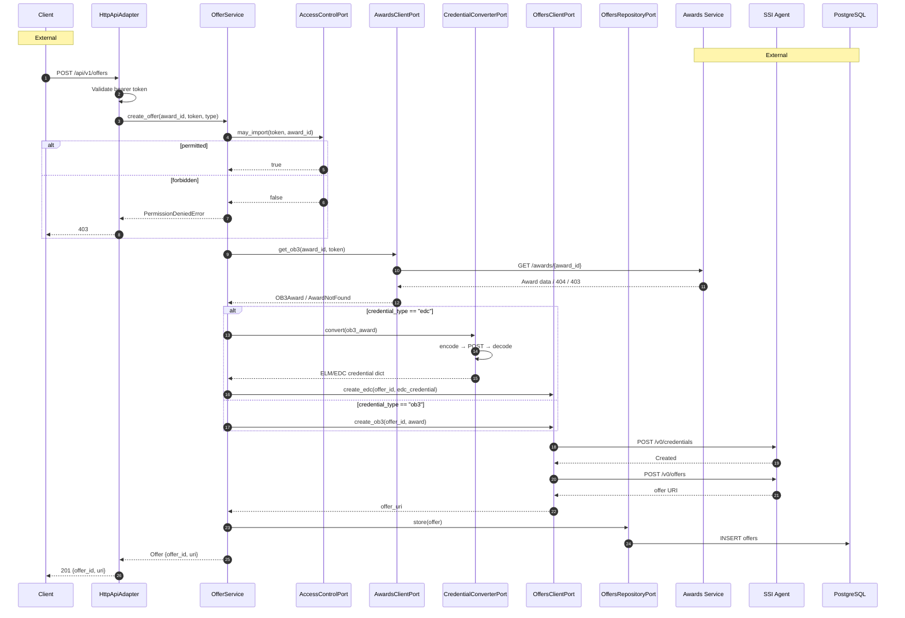
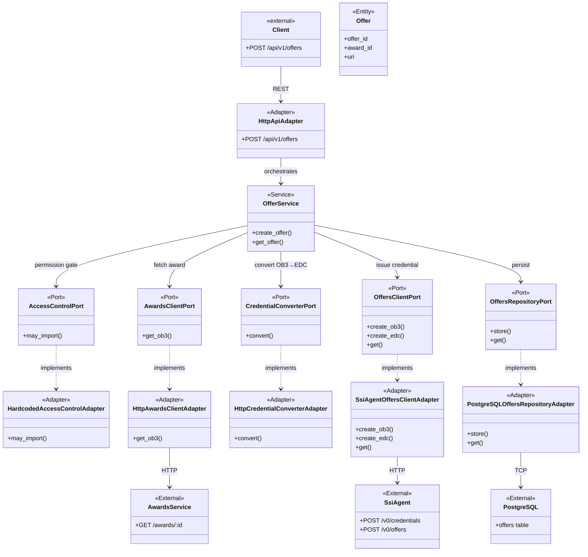

# EC-Issuer External Services Interaction

## Sequence diagram

**Visual distinction:** `Note` annotations mark external participants. See architecture diagram below for color-coded grouping.

## Architecture view

## Legend

| Style | Meaning |
|-------|---------|
| `<<Adapter>>` | Adapter (concrete implementation of a port) |
| `<<Port>>` | Port (interface the service depends on) |
| `<<Service>>` | Domain service (business logic) |
| `<<Entity>>` | Domain entity |
| `<<External>>` | Service outside ec-issuer |
| `-->` solid | Direct call / dependency |
| `..>` dotted | Implements (port → adapter) |

## External services

| Service | Protocol | Purpose | Port / Adapter |
|---------|----------|---------|----------------|
| **Awards Service** | HTTP REST | Fetch award/achievement data | `AwardsClientPort` → `HttpAwardsClientAdapter` |
| **SSI Agent** | HTTP REST (OID4VCI) | Create credentials and offers | `OffersClientPort` → `SsiAgentOffersClientAdapter` |
| **PostgreSQL** | TCP/Postgres wire | Persist offers | `OffersRepositoryPort` → `PostgreSQLOffersRepositoryAdapter` |
| **Credential Converter** | HTTP REST | Convert OB3 → ELM/EDC | `CredentialConverterPort` → `HttpCredentialConverterAdapter` |
| **Access Control** | In-process | Verify caller permissions | `AccessControlPort` → `HardcodedAdapter` |

## Flow summary

1. Client sends `POST /api/v1/offers` with `award_id` and `credential_type`
2. **Access Control** checks if the caller may import the award
3. **Awards Service** is queried to fetch the award data
4. If `credential_type == "edc"`, the **Credential Converter** translates OB3 → ELM/EDC
5. **SSI Agent** receives the credential and creates an offer, returning an offer URI
6. The offer is persisted in **PostgreSQL**
7. The client receives a `201 Created` response with the offer ID and URI